# The Grand Granny Rooster Joust — Game Guide

*Every tab, every rule, every number that matters — and, in the 🧠 boxes, the thinking behind each rule. The rules are also in the game under **More → 📖 Game Guide**.*

---

## 1. Welcome

You're a granny on a rooster, starting at **#1000 of 1,000** on the world jousting tour. Every week you ride in a tournament, win matches with well-timed strikes, earn ranking points, prize money and training, and climb — from the dusty Futures lanes to the golden helmets of the top ten.

Every one of the 999 other grannies is a full rider too: she plays her own tournaments, earns points, trains by the same rules as you, and has her own face, rooster, trait and opinions. Her matches against other rivals are played on the very same engine as yours, strike by strike.

**Your starting talent.** Before your first event you spread **10 points** over the six stats — any way you like, even all in one. Older saves get the same 10 points once.

> 📣 The whole game rests on one skill: stopping the moving marker on the centre of the gold zone. Everything else — training, money, fans — shifts the odds, but your timing decides matches.

> 🧠 **Why it works this way.** The game is a serious sports simulation wearing a silly costume, and the joke only works if the sport is real. So nothing is faked for you: all 999 rivals are full riders on the same engine, the ranking is earned week by week, and the comedy (grannies, roosters, a tabloid, solemn farewell notices) never bends a rule. The match is the heart of it, so matches are long, cinematic events and are never simulated for you. The STRIKE button never moves on the screen, so the only thing between you and the centre line is your eye and your finger.

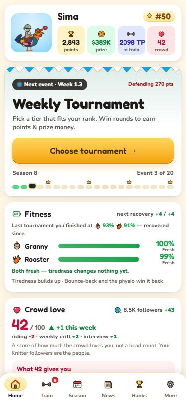
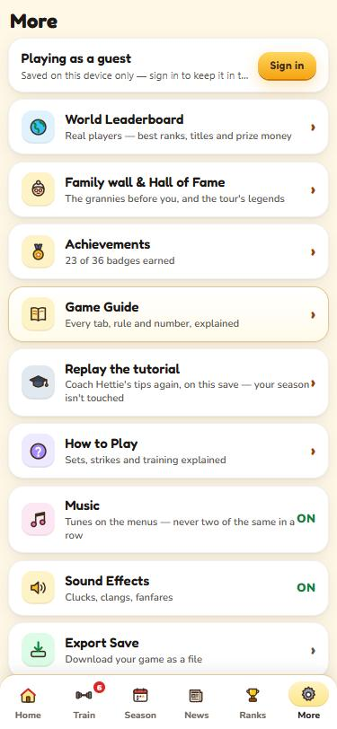

## 2. Getting around

| Tab | What's there |
|---|---|
| 🏠 **Home** | Your granny card (tap it for your profile), the next event and its button, your **fitness** (both meters, injuries, what tiredness is doing), your rival, achievements, the latest newspaper, **Tour results** (every draw of every week) and your ranking chart. At the start of a season, the off-season's **farewells**. |
| 🏋️ **Train** | Spend training points on six stats, this week's investment (private coach, physio, pedigree), and how you compare with the riders near your rank. A red badge shows how many stats you can afford. |
| 📅 **Season** | The season road map: progress through the four blocks, what's up next, what you're chasing (Grand Slam entry, the Finals), and every week's result. |
| 📰 **News** | The Daily Cluck — a fresh issue after every tournament, plus the archive. A **!** badge means an unread issue. |
| 🏆 **Ranks** | The world rankings, opening on your own row. Toggle *Around me* / *Top 50*, and tap any granny for her profile. |
| ⚙️ **More** | Your account, the **family wall & Hall of Fame**, the world leaderboard, the game guide, achievements, replaying the tutorial, the rules, music and sound switches, and saves. |

## 3. The season

A season is **20 events** in four blocks. Each block is four weekly tournaments followed by a **Grand Slam**. After the 20th event the top 16 ride in the **Season Finals**, then the season ends with a gala.

**Ranking points and defending.** Your world rank is your *season points*. Points carry over into the next season, but the points you won at a given week last season **drop off** when that week comes round again. You "defend" them: win more than last time and you climb, less and you slip. The Season tab shows what you're defending, in red. Every rival plays by the same rule, so a rank always means the points won over the last 20 weeks.

**Grand Slams.** Only the **top 64** may enter. A rider ranked 65–74 with **80+ fans** gets a fan wildcard. If you can't enter, the Slam is still played — by the 64 rivals who made it — and your week counts as a rest week (no points; last season's points for that week drop off, as they do for everyone). Slams have 64 riders, best of 5 sets, and enormous points.

**Season Finals.** The top 16 after event 20 are split into four houses of four (🔥 Phoenix, 🌊 Kraken, 🐉 Wyvern, ⚡ Chimera). Everyone plays everyone in her house (3 points a win); the four house winners meet in the semifinals and then the World Final. Every Finals match is best of 5, and every one tires you (and her). If you don't qualify, the Finals are played without you and a world champion is crowned all the same.

> 🧠 **Why it works this way.** A rank should say how a rider has been riding lately, not what she did three seasons ago. That's why points last exactly 20 weeks and then drop off, the way tennis works: a lead can't be banked, every week of the calendar matters twice (once to win, once to defend), and a slump shows up quickly. The Slams are limited to 64 and the Finals to 16 so that the big stages stay rare, and getting there means something.

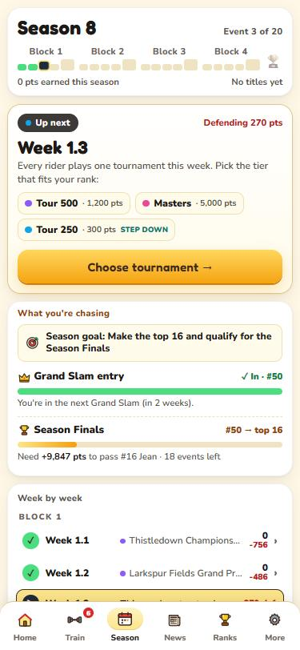

## 4. Tournaments

Tap **Choose tournament** on Home or Season. Your rank decides which tiers are open:

| Tier | Open to ranks | Sets | Champion's points | Champion's prize |
|---|---|---|---|---|
| Futures | 601–1000 | Best of 3 | 20 | $4.6K |
| Challenger | 301–700 | Best of 3 | 80 | $16K |
| Tour 250 | 101–400 | Best of 3 | 300 | $64K |
| Tour 500 | 31–200 | Best of 3 | 1,200 | $162K |
| Masters | 1–100 | Best of 5 | 5,000 | $460K |
| Grand Slam | 1–64 | Best of 5 | 10,000 | $1.6M |

Each tournament is a knockout bracket (32 riders, 64 at a Slam). Every round you win adds points and prize money; the totals above are for winning the whole thing. Lose and your week is over.

Every step up is a real step: **winning a tier is worth about reaching the quarterfinal of the tier above**, and winning one round at a Masters is worth a quarterfinal or semifinal at a Tour 500. Points you hold once you reach each round — reach the final and lose it, you keep the **F** number; win it, you get the **Win** number (shown on every tournament card):

| Tier | R16 | QF | SF | F | Win |
|---|---|---|---|---|---|
| Futures | 2 | 5 | 9 | 14 | 20 |
| Challenger | 7 | 20 | 36 | 56 | 80 |
| Tour 250 | 27 | 75 | 135 | 210 | 300 |
| Tour 500 | 108 | 300 | 540 | 840 | 1,200 |
| Masters | 450 | 1,250 | 2,250 | 3,500 | 5,000 |
| Slam (R32 400) | 1,000 | 2,500 | 4,500 | 7,000 | 10,000 |

Beating a higher-ranked rider earns no extra ranking points (the same as in tennis) — the crowd loves an upset, though.

> 🧠 **Why it works this way.** Each tier has to be a real step up. An earlier points table paid more for winning a Tour 500 than for a Masters semifinal, which rewarded hiding in a smaller tier. Now winning a tier is worth about a quarterfinal of the tier above, so moving up is always worth it once you can hold your own there. Upsets earn no extra points, because points measure how far you went, not who you beat on the way.

**Named events: pick your week**

Each week several tournaments run at once in every tier, and all 1,000 riders play one of them. Tap a tier to see its events. Each card shows:
- **A picture of the lanes** and the event's name. The lanes change the match for **both** riders, and each makes one stat count more:
  - ☀️ **Classic** — dry, packed earth on a fair day. Nothing changes: pure timing.
  - 🌧️ **Muddy lanes** — rain-soaked dirt. The roosters slip, so the bar runs 10% faster for both riders, and the **Reflexes (slower bar)** counts double.
  - 🌬️ **Windy coast** — a seaside ground in the gusts. The gold zone is 2% narrower for both, the **Steady Stride (bigger gold)** counts double, and seaside sponsors pay +10% prize money.
  - 🔥 **Heatwave** — baking sun. The bar speeds up 40% more after every strike, and the **Stamina (less speed-up)** counts double.
  - 🌼 **Village green** — soft grass at a village fete. The gold zone is 1.5% wider and every stat counts half: the underdog's best chance (−10% points and money).
- **Entrants (★).** Who signed up:
  - ★★★ tough entrants: mostly the tier's top-ranked riders, +10% points.
  - ★★ mixed entrants.
  - ★ weaker entrants: mostly lower-ranked riders, −10% points.
- **Chips** for what the lanes and the entrants change (see *Reading the chips* below), the champion's points and prize, and the two top seeds.

**🗺 Compare the 5 lanes** (top of the list) shows all five side by side, and before every match the tale of the tape opens with **Today's lanes** — the picture and the chips again. Which lanes suit you depends on your stats and your kit: strong Reflexes (slower bar) love the mud, strong Steady Stride (bigger gold) loves the wind, strong Stamina (less speed-up) loves a heatwave, and the village green helps whoever is behind on stats. The game works it out for you: a weighted stat chip says what the weighting does to **your** bar against that event's entrants — *Steady Stride (bigger gold) ×2 · you lead by 1.5 → gold zone +1.8% for you* — green when it helps you, red when it hurts. In the tale of the tape it compares you with your actual opponent.

Grand Slam weeks have a single named Slam (The Coop Open, The Swamp Slam, Wimblehen-on-Wold, The Gale Cup), each with its own lanes.

**Getting into a higher tier early**
- **Fan wildcard:** if you're ranked just outside the tier above (within 15% of its cut) and have 70+ fans, it opens for free.
- **Paid entry:** at the bottom of the tournament list you can buy your way into the tier above for this week only (it uses this week's investment).

**Stepping down a tier**
1. Any rider may enter the tier just **below** her rank range — at most **4 times a season**. The count starts again each season.
2. You choose when. It's marked **STEP DOWN** in the tournament list, with how many you have left.
3. Rivals follow the same limit. A rival steps down only when she's worn (under 45% on either meter) or carrying an injury.

> 🧠 **Why it works this way.** Access is earned by merit. Fans alone never open a tier: a wildcard only goes to a rider already just outside the cut. Paid entry costs a third of the champion's prize, so it's a gamble, not a shortcut. Stepping down is capped at four a season, so a strong rider can catch her breath in a softer week but can't farm the tier below. The five lanes exist to make your training a strategy: each one weights one stat, so the riders you can beat depend on where you choose to play.

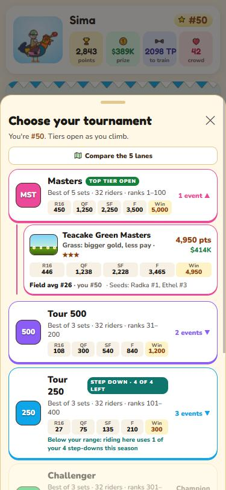
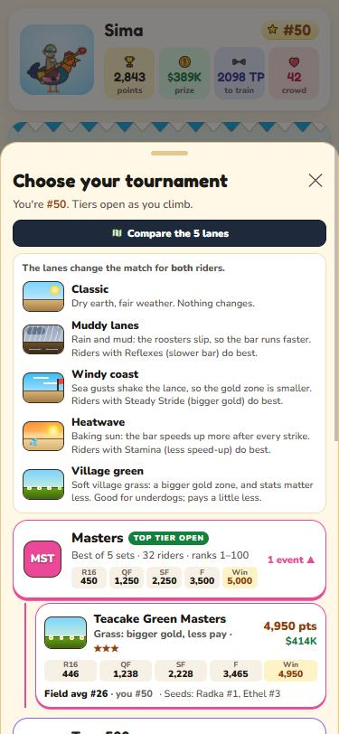

During a tournament the header shows the tier, the round, best-of and the bracket path. **Scout** opens the opponent's full report; 🌐 opens the bracket.

## 5. Reading the screens

Everything that changes a match — lanes, gear, tiredness, training, injuries — comes down to three things:

| | What it is | Better for you |
|---|---|---|
| **Gold zone** | The yellow strip. Stop the marker in it for 85–100 points | Bigger |
| **Bar speed** | How fast the marker moves (it also speeds up after every strike) | Slower |
| **Points per strike** | What an average-timed rider would score with your numbers — everything added up | Higher |

- **Tournament cards** show a picture of the lanes, one line (*Mud: faster bar*), the stars for how tough the entrants are, and the **field's average rank** next to yours — so you can judge whether to play safe or chase a tougher, better-paid event.
- **Shop items** say in one line what they help (✓ green) and what they cost (✗ red), in the lanes you picked.
- **Your numbers** at the bottom of Get ready: those three rows, for a **normal** match, **this event** (lanes, your stats against the entrants, your tiredness) and **with your kit**. Green ▲ is better for you, red ▼ worse.

> 🧠 **Why it works this way.** The game shows facts, not verdicts. It never labels an option "good for you" or picks for you; it names things plainly, gives the numbers in one line, and leaves the decision to you. The three numbers (gold zone, bar speed, points per strike) exist because every effect in the game — lanes, gear, tiredness, training, the gap between riders — comes down to them, so you can compare any two choices on the same scale.

## 6. The match

**1 · The scouting report.** Before every match a "tale of the tape" compares you side by side: **today's lanes**, world rank, season points, her talent, every stat (green where you're stronger, red where she is), **both riders' fitness right now**, the difficulty, your head-to-head, her rooster, **both riders' gear and what it does today** and **any injuries** (yours and hers). A red banner marks your arch-rival. Take your time, then tap **To the lanes!**

**2 · The opening.** The VS splash plays in full, then 3–2–1 and the announcer's **FIGHT!** Before a **final** (only a final) you first get a special build-up: the trophy, your road to the final, and your opponent revealed from the shadows.

**3 · Sets and strikes**
- A match is played in **sets**; each set is **3 strikes**.
- Each strike, you and she both score. The set goes to whoever has the **higher average** of the three, rounded as the screen shows it — one bad strike can be rescued. **Level averages (say 83–83) go to tie-break strikes** until one rider is ahead.
- Win the majority of sets: best of 3 (first to 2) up to Tour 500, best of 5 (first to 3) at Masters, Slams and the Finals. A deciding set only happens if it's needed.

**4 · Striking.** A blue marker sweeps back and forth across the bar. Tap the big round **STRIKE** button (or the arena, or press Space) when it's in the gold zone — as close to the white centre line as you can. The bar gets a little faster with every strike and every set.

**5 · Reading the screen**
- The chip at the top shows the set and strike. On the last strike of a set it turns into *Last strike of the set*, *Last strike for the match*, *Save the match* or *All on the line*, with the score you need.
- Coloured orbs under each name are that set's strikes; the bar below them is the set's running gap.
- Your strike leaves a tick on the bar, hers a red ▲. Under your score a line shows where it came from: *In the gold 92 + 2 Aim (extra points) + 3 Gear − 0 Tired = 97*. Between sets a break screen shows the set result.
- The header shows your fitness (👵 / 🐓, with 🩹 if you're injured), your kit and the lanes. If you get injured during a tournament, a red **Ouch!** note appears between matches.
- When the match is decided, the loser is unseated and the outro shows the score, points and prize.

> 📣 Progress is saved after every strike. Close the game mid-match and you'll pick up exactly where you left off.

> 🧠 **Why it works this way.** Before every match you see everything about her that she could see about you: her stats, fitness, crowd, gear and what it does in today's lanes. The match should be decided by riding, not by hidden information. Sets are three strikes and the average counts, so one bad strike can be rescued, and a match is decided over many strikes, not one lucky tap. When the decisive set comes, the screen says so in plain words, never in tennis terms that don't exist here.

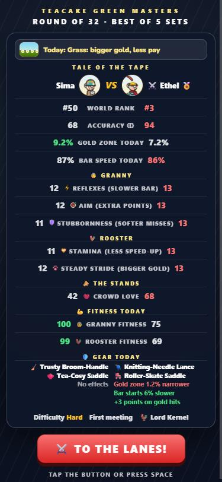
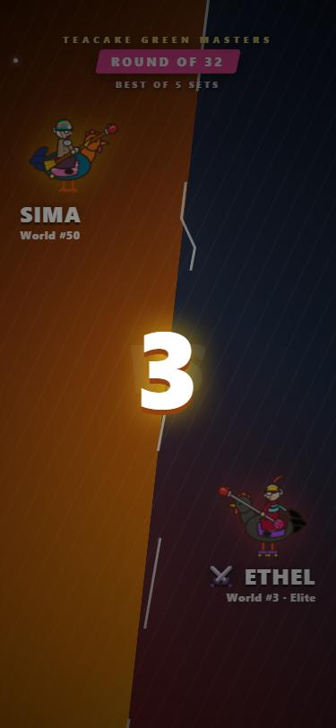

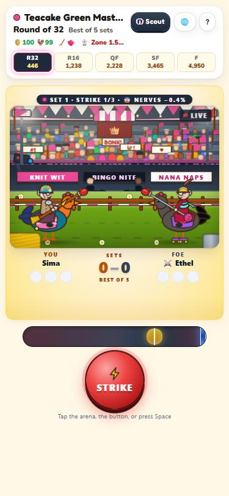
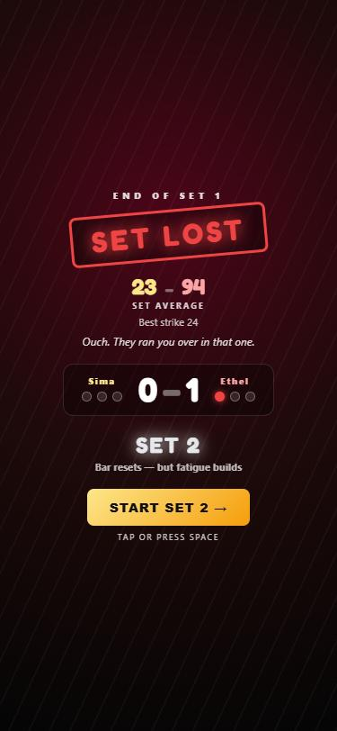

## 7. Scoring

Both of you are scored the same way: **where the lance lands on the bar.**

| Where you land | Base score |
|---|---|
| On the centre line | 100 |
| Inside the gold zone | 100 only dead on the line, 85 at the zone's edge — falling fastest near the centre (a fifth of the way out keeps about 95, half way about 91) |
| Just outside the gold | A sharp drop to 70 |
| Further out | Falls about 2 points for every % of the bar, down to your floor |

The base score is **0–100**, and **100 means dead on the line**. The bonuses go **on top, with no ceiling**: a near-perfect strike with good training can read 103, and the very best riders average a little over 100.

On top of the base score:
- **Aim (extra points)** adds about +0.5 a level to every strike (a little less at high levels; level 9 is about +3.4).
- **Stubbornness (softer misses)**: misses lose fewer points, and the worst a strike can score (the floor, 15 untrained) is higher.
- **Gear** adds or takes points (on gold hits, on misses, or on every strike) — shown as *Gear*.
- **Tiredness** takes points off your misses (up to −10 when your granny is exhausted) — shown as *Tired*.
- The line under the score adds it up, e.g. *In the gold 98 + 3 Extra + 2 Gear = 103*.
- Labels follow the landing, not the bonuses: **PERFECT!** is a true bullseye (99+).
- There's almost no luck: ±1 point. The same strike always scores about the same.
- Labels: **PERFECT!** a true bullseye, **GOLD!** inside the zone, **CLOSE** just outside, **MISS** beyond.

**How your opponent scores.** She strikes on **her own bar**, built exactly like yours but from **her** levels, her lanes, her kit, her tiredness and her crowd, and she's scored by the same rule. Where she stops is down to her **accuracy** — her talent: a gifted granny lands near the centre time after time, a developing one wobbles more, and everyone wobbles a little more as their bar runs faster. Each match she has a **form for the day** (about ±8%), and her bad strikes stay bad, not disasters: a set in the 20s or 30s only comes from real weakness or tiredness.

**Talent and potential.** A rival's talent grows slowly through her career, up to her **potential**. Nobody on the tour is below talent 60 (newcomers start at 60–62). Only **three** riders on the whole tour can ever pass 90 — one a touch above the rest, two close behind her. Below them each rider's ceiling falls steadily with her place in the talent order (about 82 for the 30th most talented, 77.5 for the 100th, 70 for the 300th), so every few dozen places down the tour is a step weaker. By ability (not ranking), a set of 100+ comes about:

1. The three strongest: one set in six to eight.
2. The 4th–10th: one in twelve.
3. The 11th–30th: one in twenty.
4. The 31st–60th: one in thirty-five.
5. The 61st–100th: one in seventy.
6. The 101st–300th: one in a hundred and fifty to four hundred.
7. Below the 300th: almost never.

A matter of chance, never a schedule.

> 🧠 **Why it works this way.** Three things were tuned together here. First, the gold zone rewards real precision: the score falls fastest near the centre line, so 100 is earned, not handed out. Second, a rival's accuracy comes from her talent with a form for the day, so the best riders are dangerous but human: they post 100+ now and then, never on a timetable, and never every set. Third, talent is a ladder. Only three riders can pass 90, then every few dozen places is a step weaker, so #31 and #800 really are different riders. A floor of 60 means even the 1000th is a real match for a new granny, because the start of a career should be a challenge, not a warm-up. The numbers above were measured over thousands of simulated sets, by ability rather than by rank, because a rank can flatter a rider and ability can't.

**Your accuracy.** Your accuracy is your own finger. Your profile measures them from your last 200 strikes (how far from the centre you stop, allowing for the bar's speed) and shows them on the same scale as a rival's talent — "Your accuracy ≈ 64". It's a mirror only; it never changes a score.

**The gap in ability.** Each rider's ability is her usual strike from her talent and training alone (gear, tiredness and lanes don't count — they come and go). The stronger rider's gold zone grows and the weaker one's shrinks, by 0.15% of the bar per point of difference, at most 1% each (a gap of about 7 points or more). Two riders of a level feel nothing; a qualifier facing one of the three best feels it all. The weaker rider's part fades with every set she wins. It works the same for you, for her, and in rival-vs-rival matches. The status line in the match shows it (😰).

> 🧠 **Why it works this way.** It used to be rank that rattled the weaker rider, but a rank can lie: a rider coming back from injury is ranked low and rides well. Ability (talent plus training) is what really separates two riders, so that's what counts. Gear is left out on purpose: it comes and goes, and sometimes a rider has none. The effect is small, so the gap tilts a match without deciding it. A #900 facing one of the three best feels it, two riders of a level feel nothing, and winning a set eases it.

**The stands.** Whoever the crowd loves more gets a slightly wider gold zone: **+1% of the bar per 25 ❤️ more** than the other rider (at most +1.5%), **doubled on the last strike of a set when the match is on the line**.

## 8. Difficulty

| What | What it does |
|---|---|
| 1 · Your levels | Your own levels build your own bar: a slower bar, a wider gold zone, extra points, softer misses. Her levels build her bar, never yours. |
| 2 · The round | Each tier starts a step harder, and each round adds a little more: a narrower gold zone and a faster bar for both of you. |
| 3 · Accuracy | Where you stop is your finger. Where she stops is her talent (how close to the centre she lands, a little worse on a faster bar, with a form for the day). Your profile shows your hands on the same scale. |
| 3b · The gap | Each rider's ability is her usual strike from her talent and training alone (gear, tiredness and lanes don't count — they come and go). The stronger rider's gold zone grows and the weaker one's shrinks, by 0.15% of the bar per point of difference, at most 1% each (a gap of about 7 points or more). Two riders of a level feel nothing; a qualifier facing one of the three best feels it all. The weaker rider's part fades with every set she wins. |
| 4 · The lanes | Mud, wind, heat or green bend the bar for both of you and weight one stat. |
| 5 · Kit and tiredness | Your lance, saddle and fitness bend your bar; hers bend hers. |

Example — the width of your gold zone with Steady Stride (bigger gold):

| Situation | Gold zone |
|---|---|
| Futures round 1, no training | 12% of the bar |
| Same, Steady Stride 5 | 13.7% |
| Same, Steady Stride 10 | 15% |
| Masters final, Steady Stride 15 | about 6.6% |

The gold zone never shrinks to nothing: once it is under 8% of the bar, every further squeeze (a late round, a stronger rider, wind, tiredness, gear) counts less and less, so it bottoms out around 4–5%. The bar never gets impossibly fast or slow either.

> 🧠 **Why it works this way.** Difficulty climbs with the tier and the round, so a final feels like a final. But the zone never disappears and the bar never becomes a blur, because a match you can't possibly win isn't hard, it's broken.

## 9. Stats & training

Six stats, each from level 0 to 20 (lower later in a career — see *Age, retirement & legends*) — each one moves one element of the match, and the game always names it with the stat: **Reflexes (slower bar) · bar speed**, **Steady Stride (bigger gold) · gold zone**, **Aim (extra points) · every strike**, **Stubbornness (softer misses) · misses**, **Stamina (less speed-up) · speed-up**, **Bounce-back · recovery**. three for the granny, two for the rooster, and 🔋 Bounce-back for recovery. Every level builds **your own bar**; her levels build hers. Each level gives a little less than the one before (level 20 works like 11). A new granny starts with **10 points** to spread however she likes. An injury knocks a few levels off a stat until it heals.

| Stat | What it does | Each level (first levels) |
|---|---|---|
| ⚡ Reflexes (slower bar) | The marker sweeps slower | Bar 3% slower |
| 🎯 Aim (extra points) | Extra points on every strike | +0.5 points per strike |
| 🛡️ Stubbornness (softer misses) | Your bad strikes aren't as bad | Misses lose 5% fewer points, floor +1.5 |
| 🫀 Stamina (less speed-up) | The bar speeds up less as the match goes on | 7% less speed-up |
| 🐾 Steady Stride (bigger gold) | A wider gold zone | +0.4% of the bar |
| 🔋 Bounce-back | Granny and rooster win back more fitness after every tournament | about +0.5% fitness back, each level a little less (double in a rest week; not against her) |

**Training points (TP).** Everyone on tour — you and every rival — earns TP by the same rule every week: **8 for turning up, plus more for every round you win** — the deeper the run and the higher the tier, the more:

| Tier | Out in R1 | R16 | QF | SF | F | Win |
|---|---|---|---|---|---|---|
| Futures | 8 | 13 | 19 | 27 | 41 | 63 |
| Challenger | 8 | 19 | 33 | 58 | 91 | 146 |
| Tour 250 | 8 | 30 | 58 | 108 | 174 | 285 |
| Tour 500 | 8 | 52 | 108 | 208 | 341 | 563 |
| Masters | 8 | 96 | 208 | 408 | 674 | 1,119 |
| Grand Slam (R32 96) | 8 | 185 | 408 | 808 | 1,341 | 2,230 |

 A deep run buys you a few levels on the riders who went out early; the edge fades once you move up to a tier where everyone is winning that much. You also get **sponsor TP** from your fans (one per 10 fans).

Each level costs more than the last: 15 TP for level 1, 30 for level 2, 45 for level 3… up to 165 for level 10. From level 11 each level costs almost double the one before (314, 596, 1,132, 2,150…), so every rider tops out at her own height: the best reach 14–16 in a stat over a long career, and nobody maxes them all.

> 🧠 **Why it works this way.** Everyone trains by the same rules, so a rival's levels mean what yours mean. The price nearly doubling after level 10 is what keeps the tour honest over many seasons: without it the whole top of the tour ended up at 20 in everything and the best could no longer be told apart. Now each rider tops out at her own height. Training makes you better, but the top 10 belongs to sharp eyes and fingers, not to hours put in. In a simulated career on a fresh tour, a player with average accuracy (about 55) settles around #70–200, a sharp one (about 68) around #40–90, and only exceptional hands (about 82) reach the top 10, after a dozen seasons. When the prices changed, every rider's levels, yours included, were re-bought at the new prices from exactly the points she had spent, with the change returned as training points.

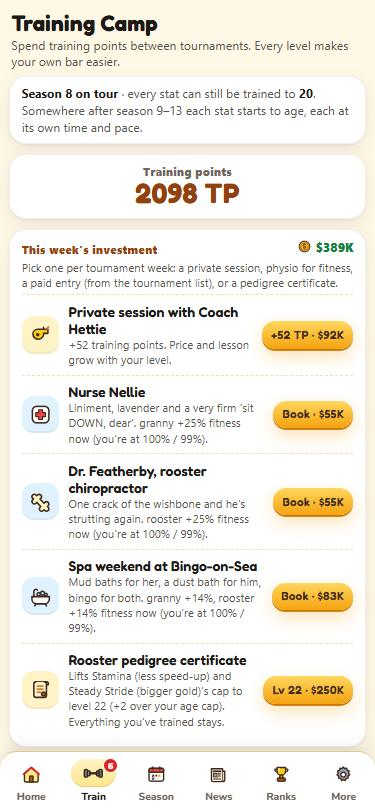
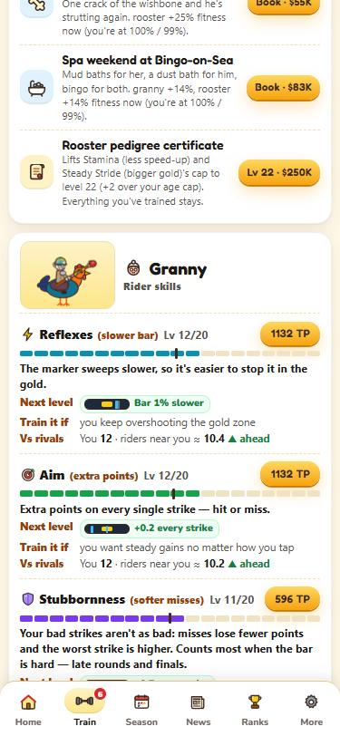

**On the Train tab**
- Each stat shows what it does, its exact per-level effect as a chip, and when it's worth training.
- The dark tick on each bar, and the "Vs rivals" line, show the average level of the riders ranked near you — ahead, behind or level.
- Every level you buy plays a quick gag: a swatted fly, a bullseye, a bounced pillow, a treadmill, a balance beam.

## 10. Lances & saddles

After you pick a tournament you land on **Get ready**. Choose a lance and a saddle from **your locker**, or buy new ones at **Mavis's shop**. Nothing is paid or used up until you press **Confirm & ride**, so change your mind as often as you like; ✕ goes back to the tournament list.

- The **🧹 Trusty Broom-Handle** and the **🫖 Tea-Cosy Saddle** are free, neutral and always yours.
- Everything else lasts a set number of tournaments (1, 2, 3 or 5). Each tournament you enter with it uses one, however many rounds you play.
- Prices follow the best tier you can enter: one tournament's worth costs about 6% of that tier's champion prize.
- **Your numbers** (bottom of Get ready), in three steps: **Normal** (classic lanes, level stats, fresh, plain kit) → **Here, you** (this tournament's lanes, your stats against its entrants, your tiredness) → **+ your kit** (or the item you're trying on). Each step is green ▲ where it helps you and red ▼ where it hurts, so you see what the lanes and your form do, and what the kit adds. **Tap any item in the shop to try it on** before you buy; pick items in your locker to compare them with the plain broom and tea-cosy.
- **Mavis's shop** has a tab for lances and one for saddles, cheapest per tournament first. Each item shows its chips **for the lanes of the tournament you picked**, and which other lanes would change it. The bar at the bottom adds up what your whole kit does in these lanes.
- Your lance and saddle are drawn on your rider — in the arena, the walk-out, the podium, the paper and your profile — and so is hers.
- Gear changes **your** bar only, never your opponent's. After each strike the breakdown shows its points as **Gear**.
- **Rivals shop too**, with prize money they actually won: each picks the kit she thinks suits the lanes (the tour's best judge it well, lower ranks guess), keeps a reserve, and books physio when worn out. Her kit shows in the tale of the tape.
- Every item helps one thing and hurts another, and the lanes shift the balance. Precise riders tend to love the needle; riders who miss a lot get more from the baguette.

> 🧠 **Why it works this way.** No item is simply better. Each one helps one thing and hurts another, and the lanes shift the balance, so the right kit depends on your stats, your hands and today's lanes. The game shows the effect and lets you try items on before buying, but it never tells you which to pick. Rivals buy kit with prize money they actually won, so a rich, well-judged rival is better equipped, just as you would be.

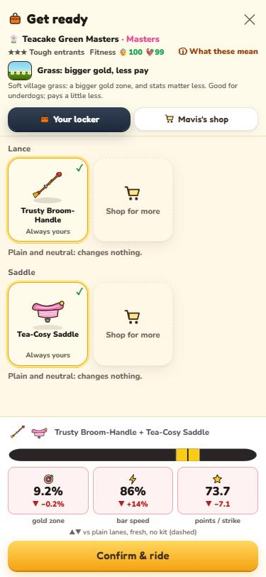
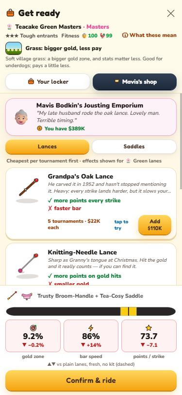

| Item | Effect | Lasts | Lanes change it |
|---|---|---|---|
| 🧶 Knitting-Needle Lance | Gold zone 0.6% narrower, +3 points on gold hits | 3 | Wind: Gold zone 1% narrower · Heat: +4 points on gold hits |
| 🥖 Day-Old Baguette | +3 points on misses, −2 points on gold hits | 1 | Mud: +1 points on misses · Heat: +4 points on misses |
| 🪵 Grandpa's Oak Lance | Bar starts 9% faster, +2 points every strike | 5 | Wind: Gold zone 0.3% wider · Heat: Speeds up 12% more each strike |
| 🎋 Featherlight Bamboo | Gold zone 1.2% wider, −2 points every strike | 3 | Wind: Gold zone 0.4% wider · Mud: Gold zone 1.4% wider |
| 🏁 Racing Saddle | Bar starts 4% slower, Speeds up 20% more each strike | 3 | Mud: Bar starts 1% slower · Heat: Speeds up 35% more each strike · Green: Bar starts 3% slower |
| 🪑 Rocking-Chair Saddle | Bar starts 3% faster, Speeds up 22% less each strike | 5 | Heat: Bar starts 5% faster · Mud: Speeds up 12% less each strike |
| 🧽 Memory-Foam Cushion | Gold zone 0.5% wider, Bar starts 3% faster | 2 | Mud: Gold zone 0.1% wider · Green: Gold zone 0.7% wider |
| 🛼 Roller-Skate Saddle | Gold zone 0.6% narrower, Bar starts 6% slower | 1 | Mud: Bar starts 1% slower · Wind: Gold zone 0.9% narrower |

## 11. Fitness & physio

You have **two fitness meters**, 0–100%: 👵 the granny's and 🐓 the rooster's. They're on Home, in the Get ready screen, in the match header and in the tale of the tape (hers too).

- **Every match tires both of you:** −3.4% granny and −4% rooster for every set you ride, so a three-set match tires you more than a two-set one, and a long tournament more than a short one. A deep run leaves you tired in the later rounds — and so is the rider who got there with you.
- **A tired granny:** the gold zone gets narrower (up to −4% at 0) and misses score less (up to −10). The strike breakdown shows it as **Tired**.
- **A tired rooster:** the bar starts faster (up to +18%) and speeds up more after every strike (up to +60%).
- **How it adds up:** tiredness carries from week to week. A rider who loses early stays fairly fresh (a typical rival starts her week at about 80%); one who keeps going deep week after week sits around half — unless she trains Bounce-back, books the physio or rests.
- **Fitness only comes back between tournaments:** 36% of whatever is missing comes back after every tournament, plus about 0.5% per level of 🔋 **Bounce-back** (each level a little less). A **rest week** brings back 75% of what's missing (and double the Bounce-back): tap **😴 Rest this week** at the bottom of the tournament list, or skip a Grand Slam you can't enter. You score no points that week and last season's points for it drop off. Only part comes back, so tiredness builds up for anyone who keeps going deep.
- **🔋 Bounce-back** is the sixth stat (0–20). Unlike the others it counts on its own, not against your opponent.
- **Physio staff** (Train tab, as the week's one investment): 👩‍⚕️ Nurse Nellie +25% granny, 🩺 Dr. Featherby the rooster chiropractor +25% rooster, 🛁 a spa weekend at Bingo-on-Sea +14% both — straight away, and it heals injuries on that side a tournament sooner.
- **On Home** the fitness card shows both meters, chips for what tiredness is doing right now, how tired you finished your last tournament, how much comes back next time, your injuries, and a warning under 35%.
- **Injuries:** ride on under 35% and every match risks one (up to 10% a match at 0). An injury knocks 2–3 levels off one or two stats for 2–3 tournaments:

| Injury | Side | Effect | Lasts |
|---|---|---|---|
| 🦵 Pulled hamstring | Granny | Reflexes (slower bar) −3 | 2 tournaments |
| 💪 Jouster's elbow | Granny | Aim (extra points) −3 | 3 |
| 🪑 Creaky back | Granny | Stubbornness (softer misses) −3 | 2 |
| 🐾 Sprained claw | Rooster | Steady Stride (bigger gold) −3 | 3 |
| 🪽 Pulled wing | Rooster | Stamina (less speed-up) −3 | 2 |
| 🦴 Bruised wishbone | Rooster | Steady Stride (bigger gold) −2, Stamina (less speed-up) −2 | 2 |

A week off counts down an injury too.
- The Season Finals tire you too, and can injure you.
- Every rider on tour plays by the same fitness rules.

> 🧠 **Why it works this way.** A deep run should cost something. Without tiredness the best riders would simply win every week; with it, every week asks a question: chase the points while tired, or rest and defend later. Fitness only comes back between tournaments and only in part, so going deep week after week wears anyone down, rivals included.

## 12. Prize money

Prize money buys **one investment per tournament week**. After you make one, the rest lock until you play that week's tournament. Prices follow the prizes at your level, so they stay meaningful as you climb.

| Investment | What you get | Price |
|---|---|---|
| 📣 Private session | +10 TP at Futures and Challenger level, 15 at the 250s, 27 at the 500s, 52 at the Masters (Train tab) | 20% of a champion's prize at your top open tier — about $900 at Futures, $90K at Masters |
| 🎟️ Paid entry | The tier above your range, this week only (tournament list) | 35% of that tier's champion's prize — about $5.7K for Challenger |
| 🩺 Physio | Nurse Nellie, Dr. Featherby or a spa weekend: fitness back now, injuries heal sooner (Train tab) | 12–18% of a champion's prize at your top open tier |
| 🧬 Pedigree certificate | Raises the cap on Stamina (less speed-up) and Steady Stride (bigger gold): 20 → 22 → 24 → 26 | $250K, $1M, $3M |

Lances and saddles from Mavis's shop are bought on the Get ready screen and don't use the weekly investment. The world leaderboard counts everything you've ever earned, so spending never costs you places there.

> 🧠 **Why it works this way.** Money should speed you up without replacing the grind, so it buys one investment a week and prices follow your level. The private session used to give 10 training points everywhere, which at Masters level cost $92K for almost nothing; now the lesson grows with your level as the price does. Even booking it every week moves a career by only a few levels.

## 13. Crowd love, Knitter & the press

Your **crowd love** (❤️, 0–100, starting at 20) is a score of how much the crowd loves you — not a head count; your Knitter **followers** are the people. The **Crowd love & Knitter** card on Home (tap ❤️ Crowd at the top to jump to it) shows your crowd love, how much they moved this week and why (*riding +6 · interview +3 · weekly drift −1*), and your Knitter followers.

**What crowd love gives you** (the card shows each in numbers, and 📜 opens all the rules)
- **Sponsors:** one training point every week for each 10 ❤️.
- **Wildcards (only if you are nearly in):** 70+ fans and a rank within 15% of the tier above's cut (Tour 500: 201–230, Masters: 101–115); for a Slam, 80+ fans and rank 65–74.
- **The stands:** the crowd backs whichever rider it loves more — a slightly wider gold zone for the favourite (up to +1.5% of the bar), doubled on the last strike when the match is on the line. Your rivals have crowds too; the tale of the tape shows both (📣 The stands).

**What moves it**
- **Riding:** each win +1, a comeback +2, a real upset +2, each loss −1 (at most +6 a week), plus a title bonus (+4, +10 for a Slam). The closer you are to 100, the harder each point comes.
- **Interviews:** see below.
- **Promises:** a bold answer is a promise for the next tournament — reach the semifinals and it's +6; fall short and it's −5.
- **Revenge:** beating your rival +3.
- **Drift:** each week fans drift a little towards a baseline set by your fame (30 for most, up to 60 in the top 10) — **raised by your Knitter followers** (1K followers +3, 10K +6, 100K +9).

**🧶 Knitter** is the granny social network, where posts are called *knits*. Everyone on tour has followers. Yours grow with wins, titles (a Slam title brings thousands), well-liked interviews and viral moments, faster the more famous you are. Read them on **Home → Knitter**: the newest knits show there, and a tap opens the whole feed with selfies, replies and what's trending. The paper points there each week.

**The press conference.** Before you answer you see what this outlet's readers love and dislike, and every answer is labelled: 😏 cheeky dig, 🙈 daft excuse, 😇 good sport, 💪 bold promise. There's no dice: the result comes from the readers' taste, the moment (a humble winner, a gracious loser, a dig at your rival…) and whether you repeat last week's kind of answer. A well-liked answer can go viral and double. Afterwards the screen shows every point and why.

> 🧠 **Why it works this way.** The crowd is flavour with a small edge, never a shortcut. It can tilt a gold zone a little and pay a few training points; it can never open a tier on its own. Interviews have no dice: the result comes from what the readers like and what you said, so you can learn to play the press.

## 14. The Daily Cluck

A new issue prints after every tournament, and you can read it any time in the News tab (with the archive of recent issues).
- **The front page** goes to the week's biggest story — a Slam champion, a new world #1, a Cinderella title, a giant-killing, or you if you earned it.
- **Your week:** points, prize money, your best win, who knocked you out, and your interview quote with the crowd's verdict.
- **The feud:** what your rival did this week and your head-to-head.
- **Around your ranking:** who's climbing and falling near you, and gym gossip.
- **World tour:** the top five and the week's biggest title.
- Every story names the actual tournament — *"won the Puddleby Fete Cup as an outsider"* — and the photos show each rider's kit.

When it opens after a tournament, tap **Fold the paper** to put it away.

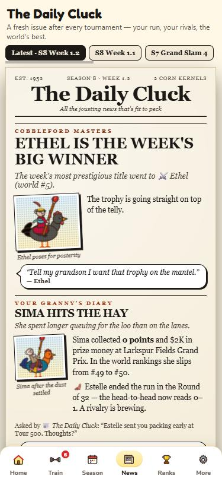
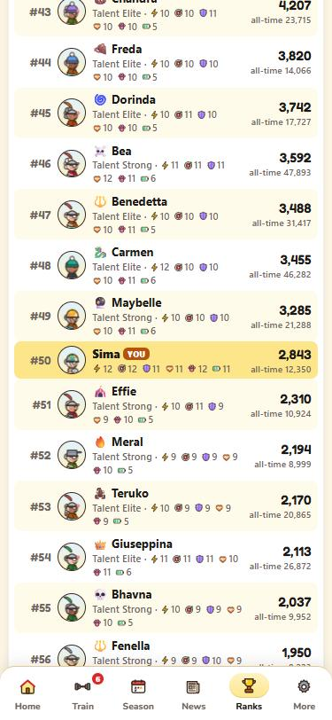

## 15. Rivals

Your **arch-rival** is the granny you keep meeting — preferably the one who keeps beating you. She's picked from your head-to-head record after each tournament (at least two meetings and one loss to her).
- She shows on Home, with a red banner before your matches, a badge on her profile, and her own column in the paper.
- Beat her for **Sweet Revenge** (+3 fans).
- Lead her head-to-head by three and the feud is **settled** — she stops bothering you, and the next grudge can take her place.

## 16. Rankings & profiles

The Ranks tab lists all 1,000 riders by season points and opens on your own row, with 25 above and below ("show 25 more" to see further). Switch to **Top 50** to see the leaders. Golden helmets mark the top ten; the world #1 wears the crown.

**Profiles.** Tap any granny for her profile: her rider and rooster, trait and quote, ranks and points, crowd love and followers (and what they mean when you meet), natural talent (her hands) and potential — or, on yours, your measured hands — training levels, titles, and your head-to-head — every match with its result in sets and each set's score.

Tap your own card on Home for your profile. The ✏️ buttons rename your granny and your rooster.

**Week by week.** Every profile ends with each tournament she rode this season and last, the round she reached and the points she won. Tap a week to see that tournament's whole draw, with her path lit up.

**Tour results**
1. **Tour results** on Home opens every tournament of a week — yours and all the others — with each champion. ‹ › step between weeks.
2. Tap a tournament for its full draw, round 1 to the final. Tap a name in the draw for her profile.
3. The search box finds any granny by name. The Season tab (tap a played week) and the paper (*Every draw of the week*) open the same list.
4. The tour keeps every week of this season and last; older seasons keep each rider's best round and titles in every tier.

## 17. Achievements

**35 achievements** in six groups — on the tour, with the lance, the ladder, feuds, crowd & press, and the gym. A badge slides down from the top when you earn one; Home and More show your collection, with progress bars on the counted ones and how to earn the ones you're missing.

## 18. End of season

When the season is over, the **Grand Gala** plays: the world champion is crowned, the season's awards are handed out one envelope at a time (most titles, biggest climb, most training, your best quote, fan favourite — and the participation ribbon), your season in numbers, the hall of the golden helmets, the grannies who retire this year (*In memoriam, mostly* — with how each one left), anyone entering the **Hall of Fame**, and a goal for next season.

Your training, prize money, lances and saddles, badges, fans, rival and newspaper archive all carry over into the new season (your fitness starts fresh and injuries heal over the break) — and so do last season's points, which you'll defend week by week.

## 19. Age, retirement & legends

Grannies get older, and every rider ages by the same rules — you included. Age is counted in **seasons on the tour** (your profile and the Train tab show yours).

**Each stat ages on its own**
1. Each stat has its own first season of decline, somewhere after season 9 to 13, and its own pace (slow, average or fast). Both are fixed for each granny when she starts, and nobody knows them in advance.
2. When a stat starts to age, it gets a ceiling: the level it holds then (at least 12). From then on the ceiling drops every season, about a quarter of a level at first and a little faster each year, with a dice roll on top. It never goes back up.
3. Levels above a ceiling are lost at the start of a season. The rooster pedigree still adds its levels on top.
4. So one granny's Reflexes fade early while her Aim holds for years, and the next one the other way round. The Train tab shows each stat's ceiling once it has one.

A top rider's five stats together (out of 100), typically:

| Season on tour | 10 | 13 | 16 | 20 | 25 | 30 |
|---|---|---|---|---|---|---|
| Five stats together | 76 | 76 | 72 | 65 | 53 | 41 |

**Retirements and newcomers**
1. At the end of each season about 50 rivals retire. Nobody retires before 8 seasons; after that the chance grows with age, and riders ranked low go sooner.
2. Each one is replaced by a newcomer who starts at the bottom of the ranking with her own talent and potential. Now and then a prodigy arrives.
3. The gala says goodbye (and how each one left), Home lists the best of them, and the Knitter posts the farewells. If your rival retires, a new grudge will find you.

**Your own retirement**
1. From season 15 on the tour, the gala's last page lets you retire. It's always your choice.
2. A retirement ceremony follows: a lap of honour, your career in numbers, and the family torch passed to the granny who takes over.
3. Your career goes up on the **family wall** (More tab): your portrait, best world rank, Grand Slams and Masters titles.
4. The next granny of your family starts from nothing, in the same tour with the same rivals: #1000, first season, 10 starting points. Your badges stay yours.

**The Hall of Fame.** Very hard to enter: all four Grand Slams, or 8 Grand Slams, or year-end No. 1 three seasons running. Riders are judged when they retire — rivals and you alike. The Hall is on the More tab, next to the family wall.

> 🧠 **Why it works this way.** A career should rise, peak and fade, and no two should fade alike. That's why each stat ages on its own schedule and at its own pace, drawn when the granny starts, so one keeps her Reflexes and loses her Aim and the next the other way round. The ceiling starts at the level she holds, so potential drops first and the levels follow. Retirements (about 50 a year) and newcomers keep the tour moving instead of freezing at the top. Your own career can end too, but the game doesn't: the family torch passes to the next granny, in the same world, so your history stays part of it. The farewells are deliberately dull, formal notices, because that's the joke. And the Hall of Fame is very hard to enter on purpose, so it means something. The game doesn't give you a hidden potential: your real potential is your own hands, and the game already measures those.

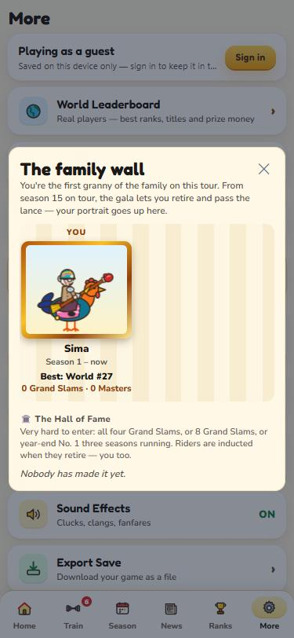

## 20. Settings & saves

| In More | What it does |
|---|---|
| 👤 Account | Sign in to keep your career in the cloud and on the world leaderboard, or log out. Guests are saved on this device only. |
| 🌍 World Leaderboard | Real players ranked by best rank, career prize money or titles. |
| 📖 Game Guide | This guide. |
| 🏅 Achievements | Your badge collection. |
| 🎓 Replay the tutorial | Coach Hettie's tips again, on this save — your season isn't touched. |
| ❓ How to Play | The quick rules card (also the ? button in matches). |
| 🎵 Music / 🔊 Sound Effects | Separate switches. Menu tunes play around the matches, battle tunes only during a match. |
| 💾 Export / 📂 Import | Download your save as a file, or load one back. |
| 🔄 Restart Game | Erases this save and starts over. |

The game saves after every change — every strike, every level, every answer — in a compact format (about 100 KB for the whole tour of 1,000 riders).

## 21. Coach's tips

- Aim for the white line, not just the gold. 100 against 86 is the difference between winning and losing a set.
- If you keep overshooting, train Reflexes (slower bar). If you land just next to the gold, train Steady Stride (bigger gold). If your misses are wild, Stubbornness (softer misses).
- Long best-of-5 matches get faster as they go: Stamina (less speed-up) keeps them under control.
- Watch the "Vs rivals" line — falling behind the riders near you is felt immediately.
- A title is worth far more training than a quarterfinal. Stay in a tier you can win before you jump up.
- Save the paid entry and wildcards for weeks you feel sharp.
- Keep your interviews varied — the crowd gets bored of the same joke.
- Watch the fitness card after a deep run. Under 35% you're gambling on an injury: book the physio, or skip a Slam you can't win.
- Pick lanes that suit your stats: check *Compare the 5 lanes* against the stat you're strongest in.
- Precise? Try the knitting needle. Missing a lot? The baguette softens the misses.
- Promises are risky: only make a bold promise if you really expect a semifinal.

---

*Good luck on the lanes, dear.*
